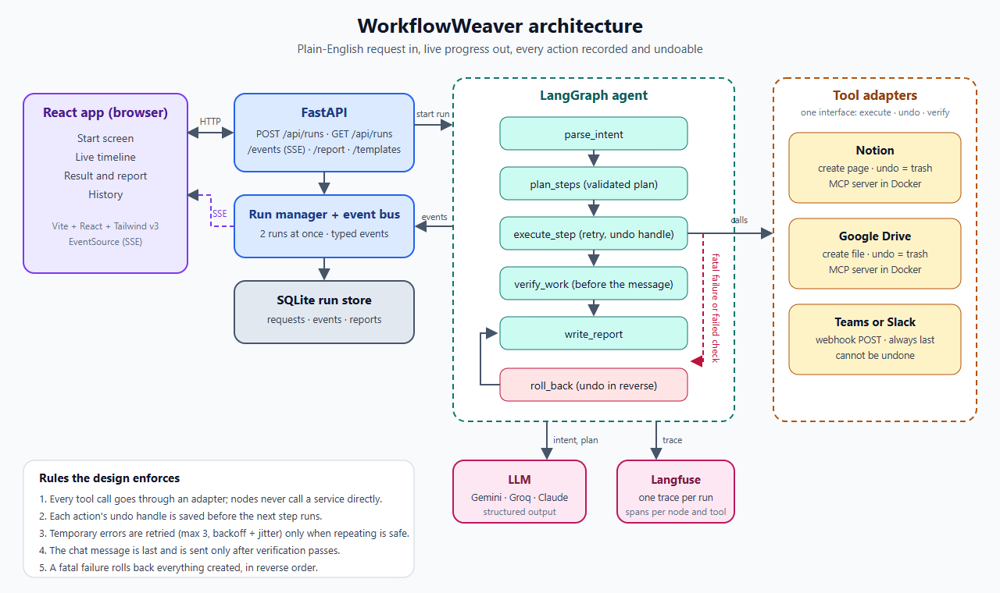

# WorkflowWeaver

Describe a business workflow in plain English. A LangGraph agent plans it, runs it across **Notion**,
**Google Drive** and a **Microsoft Teams or Slack** chat message, streams every step to the browser live,
records a trace in **Langfuse**, retries temporary failures and **rolls back** what it created if something
breaks for good.

> All sample data in this project is synthetic. Never put real customer, employee or company data into
> the app, its traces or its run history.

## Contents

1. [Project Overview](#1-project-overview)
2. [Architecture Description](#2-architecture-description)
3. [Setup Instructions](#3-setup-instructions)
4. [Environment Variables](#4-environment-variables)
5. [Frontend Run Instructions](#5-frontend-run-instructions)
6. [Backend Run Instructions](#6-backend-run-instructions)
7. [Sample Workflow Examples](#7-sample-workflow-examples)
8. [Known Limitations](#8-known-limitations)

---

## 1. Project Overview

**The problem.** Running a routine such as "turn today's meeting notes into tasks, file a copy and tell the
team" means copying text between three tools by hand. WorkflowWeaver does it from one request.

**What a user does.** They either pick one of three templates (Meeting to tasks, Sprint planning, Incident
response) and fill in a short form, or type a request in their own words. They press **Run workflow** and watch
a live timeline. When the run ends they see a plain-language result, links to everything that was created, a
downloadable JSON report and a link to the trace.

**What the agent does.**

| Step | What happens |
|---|---|
| Understand | The LLM turns the request into a structured intent (title, owners, due dates, decisions). |
| Plan | The LLM proposes an ordered list of steps. The plan is validated against the tool catalogue: only known tools and actions, no more than 10 steps, the chat notification always last. |
| Execute | Each step runs through a tool adapter. Temporary failures are retried (up to 3 times, with growing, randomised delays). |
| Verify | Before the notification is sent, the agent reads back what it created (is the Notion page there, is the Drive file in the folder). |
| Roll back | If a step fails for good or a check fails, everything already created is undone in reverse order (moved to the trash). The user sees each undo. |
| Report | A JSON report and a human summary are stored, and the trace is closed. |

**Tools used**

| Tool | How it is connected | Used for |
|---|---|---|
| Notion | Official Notion MCP server (Docker) | A page with the summary, action items and decisions |
| Google Drive | Google Drive MCP server (Docker) | A Markdown copy of the notes |
| Slack **or** Microsoft Teams | Plain incoming-webhook POST, chosen by `NOTIFIER_PROVIDER` | The final message that tells the team |
| Langfuse | Python SDK | One trace per run with a span for every node, tool call and LLM call |

The LLM is switchable between Google Gemini, Groq and Anthropic Claude through `LLM_PROVIDER`.

---

## 2. Architecture Description



### Components

| Part | Where | Role |
|---|---|---|
| React app | `frontend/` | Start screen, live timeline, result and report, history. Talks to the API over HTTP and one `EventSource` (SSE) per run. |
| API | `backend/app/main.py`, `backend/app/api/` | FastAPI. Starts runs, streams events, serves reports, history and templates. At most 2 runs at the same time. |
| Run store | `backend/app/store/` | SQLite (standard library). Keeps each run's request, every event and the final report, so a page refresh or a later visit can replay a run. |
| Event bus | `backend/app/events.py` | The only way the agent talks to the outside: nodes publish typed events, the API turns them into SSE and the store saves them. |
| Agent graph | `backend/app/agent/` | The LangGraph state machine (below). One node per file in `nodes/`, state only in `state.py`. |
| Tool layer | `backend/app/tools/` | One adapter per tool, all with the same interface: `execute`, `undo` and a read-back check. Nodes never call a service directly. |
| MCP sessions | `backend/app/tools/mcp_session.py` | Starts the Notion and Drive MCP servers on demand with `docker run -i` and talks MCP over stdin/stdout. |
| Tracing | `backend/app/observability/` | Langfuse tracer. One trace per run, tagged with the run id. |

### The agent graph

```
parse_intent -> plan_steps -> execute_step (once per step) -> write_report
                                  |   ^                          ^
              just before the     v   |                          |
              notification     verify_work ----------------------+
                                  |
       fatal failure or a        +--> roll_back --> write_report
       failed check
```

- **Structured output.** The intent and the plan are Pydantic models filled by the LLM. There is no parsing of
  free text. A plan that names an unknown tool, has no notification last or exceeds 10 steps is rejected.
- **Undo is recorded before the next step.** Every successful action stores an undo handle in the state
  immediately, so rollback always knows what exists.
- **Retry policy.** Only temporary errors are retried, and only when it is safe: if the outcome of a call is
  unknown (for example a Notion page create whose reply was lost) it is not repeated, because that could make
  a duplicate. Rate-limit answers (HTTP 429) are never retried.
- **Verify before the irreversible step.** A chat message cannot be unsent, so the agent checks its work first.
  If the final notification itself fails, the run ends as *completed with a warning* and keeps the work.
- **Rollback is undo, not delete.** Created Notion pages and Drive files are moved to the trash, where they can
  be restored. A failed undo is listed for the user to clean up by hand.
- **Drive names are unique per run.** The file is named `<title> (<8 characters>).md`, so two runs with the same
  title never collide, and a retry after a lost reply finds and reuses its own file.

### Live events

`GET /api/runs/{id}/events` sends Server-Sent Events: `run_started`, `plan_ready`, `step_started`,
`step_succeeded`, `step_retry`, `step_failed`, `verify_started`, `verify_step`, `rollback_started`,
`rollback_step`, `run_completed` (always last). Each event has a sequence number; a client that reconnects with
`Last-Event-ID` resumes where it stopped. A finished run is replayed from SQLite.

### API summary

| Method and path | Purpose |
|---|---|
| `GET /api/health` | Status, configured providers, database check |
| `GET /api/templates` | The three workflow templates and their form fields |
| `POST /api/runs` | Start a run from free text, or from a template id and values. Optional `simulate` (see section 7). Answers 202, 422 for bad input, 429 when 2 runs are already active. |
| `GET /api/runs` | Run history (most recent first) |
| `GET /api/runs/{id}` | One stored run: request, status, report (empty while it is still running) and trace link |
| `GET /api/runs/{id}/events` | The live event stream (SSE) |
| `GET /api/runs/{id}/report` | The JSON report as a download |

---

## 3. Setup Instructions

### Prerequisites

| Needed | Version | Why |
|---|---|---|
| Python | 3.10 or newer | Backend |
| Node.js and npm | 22.22 or newer (or 24) | Frontend and the one-time Drive login. The test tooling asks for this; Node 22.16 also worked, with `EBADENGINE` warnings from `npm install`. |
| Docker Desktop | any recent | Runs the Notion and Drive MCP servers |
| Accounts | Notion, Google Cloud, Langfuse, an LLM provider, and Slack **or** Teams | Credentials, see below |

### Step 1 - Get the code and create `.env`

```bash
cd WorkflowWeaver
cp .env.example .env        # Windows PowerShell: Copy-Item .env.example .env
```

The `.env` file lives in the **project root** (next to this README). It is git-ignored. Fill it in as you go
through the steps below; section 4 explains every variable.

### Step 2 - LLM key

Create a free key with one provider and set `LLM_PROVIDER` and `LLM_API_KEY`:

| Provider | `LLM_PROVIDER` | Notes |
|---|---|---|
| Google Gemini | `google` | Default. Free tier from Google AI Studio. |
| Groq | `groq` | Free tier is about 8,000 tokens a minute: roughly one workflow a minute. |
| Anthropic Claude | `anthropic` | Paid key. |

### Step 3 - Notion

1. In Notion open *Settings > Connections > Develop or manage integrations* and create an **internal
   integration**. Copy its secret into `NOTION_TOKEN`.
2. Create (or pick) an empty page to hold the pages WorkflowWeaver makes. Use *Share > Invite* (or
   *Connections*) to give your integration access to that page.
3. Copy the page id from its URL (the 32-character part at the end) into `NOTION_PAGE_ID`.

### Step 4 - Google Drive

1. In Google Cloud Console create a project, enable the **Google Drive API**, configure the OAuth consent
   screen (add yourself as a test user) and create an **OAuth client ID of type Desktop app**. Download the JSON.
2. Save it in the project root, for example as `credentials.json` (git-ignored), and set
   `GOOGLE_CREDENTIALS_PATH=credentials.json`.
3. In Google Drive create an empty folder for the files. Copy the id from its URL
   (`drive.google.com/drive/folders/<this part>`) into `GOOGLE_DRIVE_FOLDER_ID`.
4. Do the one-time login on your own machine. It opens a browser for consent and saves `tokens.json`:

   ```bash
   npx -y @piotr-agier/google-drive-mcp@2.13.0 auth
   ```

   The token goes to `~/.config/google-drive-mcp` by default; set `GOOGLE_TOKEN_DIR` only if you moved it.
   While the consent screen is in *Testing* mode Google expires the login after **7 days**; repeat this step then.

### Step 5 - Chat notification

Pick one and set `NOTIFIER_PROVIDER` to match:

- **Teams** (`NOTIFIER_PROVIDER=teams`): in a Teams channel add the **Workflows** app, choose
  *Post to a channel when a webhook request is received*, and copy the URL into `TEAMS_WEBHOOK_URL`.
- **Slack** (`NOTIFIER_PROVIDER=slack`): create a Slack app, enable *Incoming Webhooks*, add one to a channel and
  copy the URL into `SLACK_WEBHOOK_URL`.

Only the URL of the selected provider is required.

### Step 6 - Langfuse

Create a project at https://cloud.langfuse.com (or your own server), then copy its public and secret keys into
`LANGFUSE_PUBLIC_KEY` and `LANGFUSE_SECRET_KEY`. Change `LANGFUSE_HOST` only for another region or a self-hosted
server.

### Step 7 - MCP server images (one time)

```bash
docker compose --profile setup build
docker compose --profile setup pull --ignore-buildable
```

The first command builds the Drive server image, the second pulls the official Notion image. The servers are not
background services: the backend starts each one on demand for the length of a run.

### Step 8 - Install dependencies

```bash
# backend
cd backend
python -m venv .venv
# Windows: .venv\Scripts\activate      macOS/Linux: source .venv/bin/activate
pip install -r requirements-dev.txt     # requirements.txt alone is enough to run, -dev adds the test tools
cd ..

# frontend
cd frontend
npm install
cd ..
```

### Step 9 - Check it works (no credentials or Docker needed)

```bash
cd backend && pytest && cd ..          # backend tests
cd frontend && npm test && cd ..       # frontend tests
```

---

## 4. Environment Variables

All variables go in `.env` in the project root. A copy with placeholders is in `.env.example`. Secrets are never
printed or logged.

| Variable | Required | Default | Description |
|---|---|---|---|
| `LLM_PROVIDER` | No | `google` | Which provider your key belongs to: `google`, `groq` or `anthropic`. |
| `LLM_API_KEY` | **Yes** | none | API key for that provider. |
| `LLM_MODEL` | No | provider default | Model id. Empty means `gemini-3.8-flash` (google), `openai/gpt-oss-120b` (groq) or `claude-sonnet-5-5` (anthropic). Set it if your provider retires a default. |
| `NOTION_TOKEN` | **Yes** | none | Notion internal integration secret. |
| `NOTION_PAGE_ID` | **Yes** | none | Id of the Notion page that new pages are created under. |
| `GOOGLE_CREDENTIALS_PATH` | **Yes** | none | Path to the Google OAuth client JSON. Relative paths are relative to the project root. |
| `GOOGLE_DRIVE_FOLDER_ID` | **Yes** | none | Id of the Drive folder that receives the files. |
| `GOOGLE_TOKEN_DIR` | No | `~/.config/google-drive-mcp` | Folder that holds `tokens.json` from the one-time Drive login. |
| `NOTIFIER_PROVIDER` | No | `teams` | `teams` or `slack`: where the final message goes. |
| `SLACK_WEBHOOK_URL` | If `slack` | none | Slack incoming-webhook URL. |
| `TEAMS_WEBHOOK_URL` | If `teams` | none | Teams Workflows webhook URL. |
| `LANGFUSE_PUBLIC_KEY` | **Yes** | none | Langfuse project public key. |
| `LANGFUSE_SECRET_KEY` | **Yes** | none | Langfuse project secret key. |
| `LANGFUSE_HOST` | No | `https://cloud.langfuse.com` | Langfuse server URL. |
| `DATABASE_PATH` | No | `data/workflowweaver.db` | SQLite file for run history. Relative paths are relative to `backend/`. Created on first start. |
| `SIMULATE_FAILURE_STEP` | No | empty | Force a step to fail so retry and rollback can be demonstrated. Format `s2` (fatal), `s2:fatal` or `s2:transient`. Leave empty normally. |

The backend refuses to start with a clear message when a required variable is missing, or when the selected
notifier has no URL.

---

## 5. Frontend Run Instructions

```bash
cd frontend
npm install          # first time only
npm run dev          # http://localhost:5173
```

| Command | What it does |
|---|---|
| `npm run dev` | Dev server with hot reload on port 5173 |
| `npm run build` | Type-check and build the production bundle into `frontend/dist` |
| `npm run lint` | ESLint |
| `npm test` | Unit and component tests (vitest) |

The app expects the backend at `http://localhost:8000` (set in `frontend/src/api/client.ts`) and the backend only
accepts requests from `http://localhost:5173`. Run both on those ports.

Screens: the **start screen** (template cards or free text, plus a demo option to force a failure), the **run
screen** (live timeline, result card, report) and **History** (`#history`). A run has its own address
(`#run=<id>`), so a page refresh or a shared link reopens it.

---

## 6. Backend Run Instructions

```bash
cd backend
# activate the virtual environment first (see Setup, step 8)
uvicorn app.main:app --reload --port 8000
```

Check it: open http://localhost:8000/api/health. It reports the configured providers and the database. Interactive
API docs are at http://localhost:8000/docs.

| Command | What it does |
|---|---|
| `pytest` | All backend tests (no network, no Docker) |
| `ruff check app tests scripts` and `black --check app tests scripts` | Lint and format check |
| `python -m scripts.run_workflow --live` | Run one workflow from the command line, printing the same events as the browser. **Writes to real services**, hence `--live`. |
| `python -m scripts.smoke_*  --live` | One-service checks (Notion, Drive, Slack, Langfuse, LLM). They also write or spend, hence `--live`. |

Each real run uses the LLM, creates one Notion page and one Drive file, posts one chat message and writes one
Langfuse trace. Use a sandbox page, folder and channel.

---

## 7. Sample Workflow Examples

Start the backend and frontend, open http://localhost:5173, and try these. Everything below is fictional.

### A. Meeting to tasks (template)

Choose **Meeting to tasks**, press **Try with an example** and then **Run workflow**. The example is:

> Project Falcon weekly sync. Attendees: Alex, Sam, Priya.
> Alex will finalise the launch checklist by Friday. Sam will draft the customer FAQ and share it with Priya for
> review. Priya will book the demo room for next Tuesday. Decision: launch date stays on the 14th.

**Expected:** about 3 steps (Notion page with three action items and the decision, Drive file, chat message),
all green, "All done" with links to the page and the file, a **Download report (JSON)** button and a trace link. Takes
10 to 20 seconds, the first Drive step being the slowest.

### B. Sprint planning (template)

Choose **Sprint planning**, then **Try with an example**. **Expected:** a Notion page with the sprint goals and
committed items, a Drive copy and a chat message.

### C. Incident response (template)

Choose **Incident response**, then **Try with an example**. **Expected:** a Notion page with the timeline and follow-up
actions, a Drive copy, and a chat message that reports the severity.

### D. Free text

Type, for example:

> Create a Notion page called "Launch checklist review" listing: finalise the checklist (Alex, Friday), draft
> the FAQ (Sam, Monday). Save a copy to Google Drive and tell the team.

The agent plans the steps itself. The plan always ends with the chat notification.

### E. Failure drills (retry and rollback)

On the start screen open **Demo options**, choose *Simulate a temporary failure* or *Simulate a failure (shows rollback)* (it breaks step 2 by default), or call the API with `simulate`:

```bash
curl -X POST http://localhost:8000/api/runs -H "content-type: application/json" \
  -d '{"request":"Create a Notion page called Drill, save a copy to Drive and tell the team.","simulate":"s2:fatal"}'
```

| `simulate` | What you see |
|---|---|
| `s2:transient` | Step 2 fails twice with a temporary error, the timeline shows the retries and their delays, then it succeeds. |
| `s2:fatal` | Step 2 fails for good. The agent undoes step 1 (the Notion page moves to the trash), the timeline shows the undo, and the result says nothing was left behind. |

Steps are numbered in plan order (`s1`, `s2`, ...). The chat message is not sent in a failed run.

### F. Reading a run afterwards

Open **History**, pick a run, then use **Download report (JSON)**, or open the trace link to see the run's
nested spans in Langfuse.

---

## 8. Known Limitations

**Not proven against the real service**
- The **Microsoft Teams** path is fully implemented and unit-tested (Adaptive Card, error hints) but has not been
  run against a real Teams channel. Local runs used Slack. Teams also answers "accepted" without confirming that
  the message appeared.
- The **Gemini** and **Claude** providers are implemented behind the same interface but were run live only with
  Groq.
- The command-line `--cleanup` option was never run against the real services.
- A server killed in the middle of a real running workflow was tested only with a simulated restart (the stranded
  run is marked failed on the next start) and with a finished run's page while the backend was stopped.

**Behaviour to know about**
- **Slack and Teams messages cannot be unsent.** That is why verification comes first and the message is always
  last. If the message itself fails the run is reported as completed with a warning.
- **Undo means trash**, not permanent delete, for Notion pages and Drive files. If an undo fails, the item is
  listed for the user to remove by hand. A hard crash in the middle of a run can leave created items behind.
- Notion pages are plain paragraphs and a checklist of action items; there is no rich formatting.
- Some failure headlines still show a tool's own wording, and a rolled-back step's row in the report table can show
  "Done" with a link to the now-trashed item. Steps that never ran can read "Waiting" after the run has ended.
- While the browser is still reconnecting to a run it has never loaded, the page can say "running" even if the
  run has already finished.
- Drive file names are cleaned (slashes become `-`, line breaks become spaces) and shortened to 200 characters;
  Notion titles are limited to one line of 200 characters; a page holds at most 50 action items.
- The first Drive step takes around 10 seconds (the MCP container has to start and authenticate).

**Limits and quotas**
- The Groq free tier allows about 8,000 tokens a minute, so about one workflow a minute; a request that is too
  large makes the model return a broken tool call and the user is told to shorten it.
- A request is limited to 6,000 characters and a plan to 10 steps. At most 2 runs execute at once; a third gets a
  "busy" answer.
- The Google login for the Drive server expires after 7 days while the OAuth consent screen is in *Testing* mode.

**Security and data**
- Traces in Langfuse and the SQLite history contain the text of requests and results. Use **synthetic data only**.
- The app has no sign-in. It is meant to run locally for one user; the API only allows the local dev origin.
- Secrets live only in `.env` and are never logged, but webhook URLs and keys have full posting or API rights, so
  use sandbox accounts.

**Not built**
- Plan preview and approval before execution, Drive and Notion pre-warming, live Teams and Gemini/Claude
  verification, and plain-language rewrites of every failure reason were left out for time.

---

## Project layout

```
README.md  .env.example  docker-compose.yml
backend/    FastAPI app (app/), tests (tests/), live check scripts (scripts/)
frontend/   React + Vite + Tailwind CSS v3
docker/     Dockerfile for the Drive MCP server image
docs/       architecture.png
```
